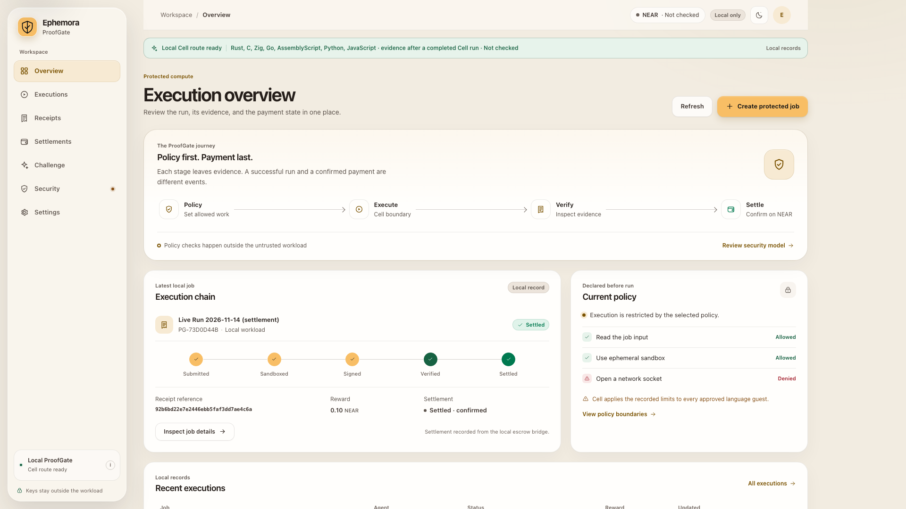
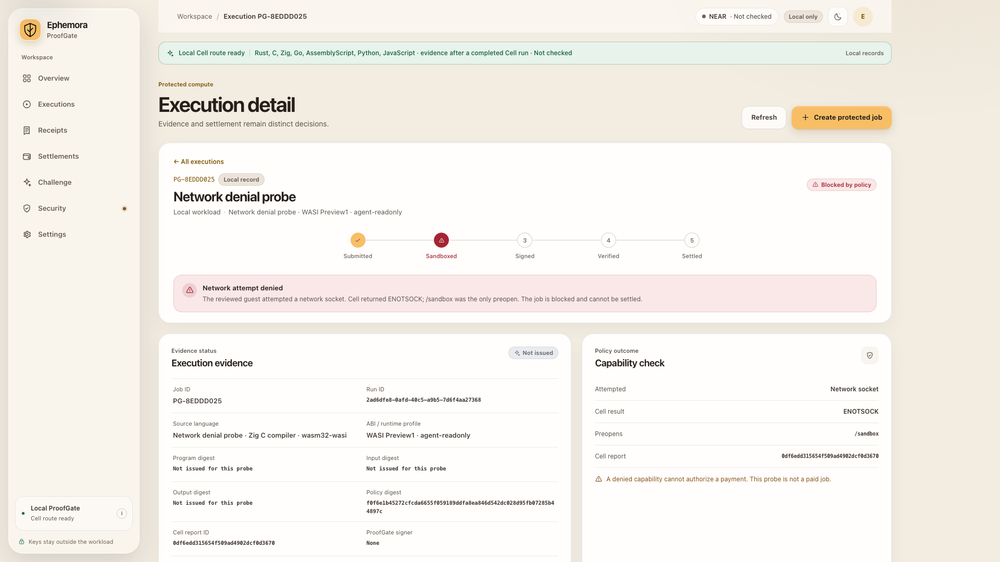
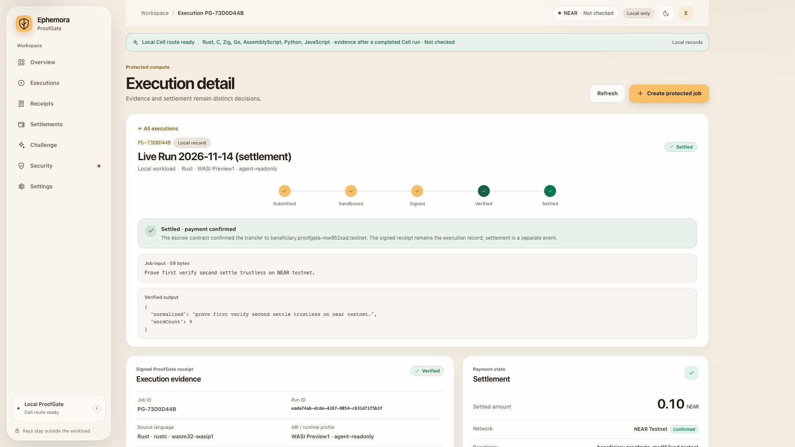
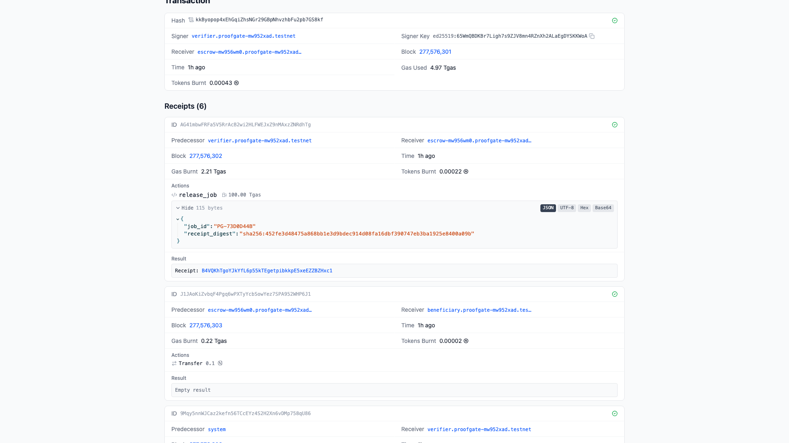
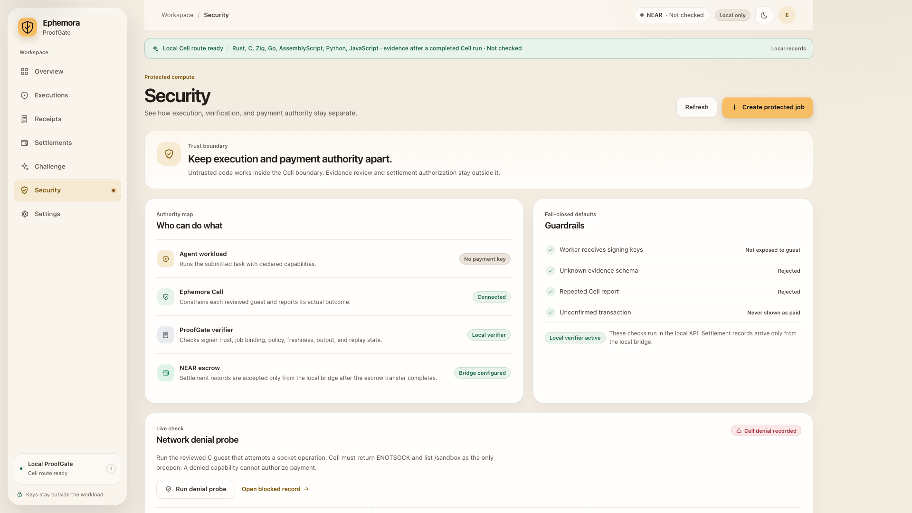

# Ephemora ProofGate

**Policy first. Payment last.**

ProofGate pays an AI agent for finished work only after independent evidence
proves the work was done, under policy, by the reviewed guest. Untrusted code
runs inside **Ephemora Cell**, a WASI sandbox that records signed evidence of
what executed. A verifier **outside** the workload checks that evidence
against the job, the policy, the expected output, freshness, and replay state.
A **NEAR escrow contract** releases payment exactly once, only to the
configured beneficiary, and only on instruction from the configured verifier.

> An agent's word is not proof. ProofGate makes payment a verdict, not a
> favor — and you can re-run every check yourself.

| | |
|---|---|
| **Tracks** | AI Security & Defense (`security`) · Agent Economy (`agents`) |
| **NEAR** | Original Rust escrow contract, deployed and settled on **NEAR Testnet** |
| **Testnet contract** | `escrow-mw956wm0.proofgate-mw952xad.testnet` |
| **On-chain proof** | `release_job` carries the signed receipt digest; 0.10 Testnet NEAR paid to the beneficiary |
| **Reproduce** | `cargo test` (11 passing) · offline verifier on committed fixtures (17 checks, exit 0; one tampered byte → exit 1) · full local sandbox e2e |
| **License** | BUSL-1.1 (see [LICENSE](LICENSE)); evaluation, research, and testing permitted |

## The 90-second story

The complete causal path in recorded evidence: a live
network-capability denial (ENOTSOCK), the real create → run → verify → settle
loop, the offline verifier passing on committed fixtures and failing on a
one-byte tamper, the 0.10 NEAR Testnet settlement whose `release_job`
arguments carry the receipt digest, and the failure path where denied work
earns nothing. Testnet only; no Mainnet transaction or real funds at any point.

## What problem this solves

Autonomous agents will earn and spend on their own. Today a buyer can only pay
on the agent's claim that the job ran: "it worked," "the output is there,"
"trust me." That is unbounded trust in untrusted code:

- A workload can **claim** it ran when it never did, ran the wrong thing, or
  fabricated plausible output.
- A workload that holds payment keys can sign its **own payout**.
- A compromised or malicious guest can exfiltrate data through the network and
  still present a happy-path result.

ProofGate separates **doing the work** from **proving the work** and moves both
outside the reach of the workload:

1. **Policy first.** The job, its allowed capabilities, budget, beneficiary,
   and expiry are fixed before execution. The reviewed guest runs inside
   Ephemora Cell with per-language ABI, memory, fuel, timeout, and I/O
   ceilings. A denied capability is a hard stop, not a warning.
2. **Evidence, not claims.** Cell returns a signed report: program, policy,
   input, output digests, runtime profile, and the actual outcome — including
   denied capabilities. The workload never holds the evidence signing key,
   the verifier key, or any payment key.
3. **Independent verification.** ProofGate's verifier rejects forged
   signatures, tampered or stale evidence, tenant mismatch, wrong outputs, and
   replayed report IDs. Only a fully passing check set produces a signed
   ProofGate receipt.
4. **Payment as a verdict.** The NEAR escrow contract accepts a release only
   from the configured verifier account, pays exactly once, records the
   receipt digest on-chain, refunds the buyer on expiry, and never marks an
   unconfirmed transfer as paid.



## The two outcomes that matter

### 1 · The guest tries the network — the sandbox says no

A reviewed probe guest attempts to open a network socket. Cell returns
`ENOTSOCK`: the workload has no socket descriptor, and its signed baseline
lists only `/sandbox` as a preopen. No network request is made. ProofGate
records the job as **Blocked by policy**, issues **no receipt**, and the
settlement is **no payout**.



### 2 · The verified job settles on NEAR Testnet

Job `PG-73D0D44B` (2026-11-13) ran the reviewed Rust guest through Cell, passed
every verification check, and settled **0.10 Testnet NEAR** to
`beneficiary.proofgate-mw952xad.testnet`. The same live run also proved the
negatives: a release from the attacker account was rejected and the job stayed
`Open`, and a second release attempt was rejected while the job stayed `Paid`.
`Verified` and `Settled` remain distinct states in the product: verification
alone never moves funds.



On-chain, the release is a single `release_job` call whose arguments carry the
receipt digest, signed by the verifier account, followed by exactly one
`Transfer 0.1` to the beneficiary:



Explorer evidence (Testnet only, throwaway accounts, faucet funds):

| Action | Transaction |
|---|---|
| Job PG-73D0D44B — create | [`4dT5X1qm…mwHD`](https://explorer.testnet.near.org/transactions/4dT5X1qmaVeBmYpLiQEnF9MWGDdRteJREvGDFuc9mwHD) |
| Job PG-73D0D44B — release (0.10 NEAR) | [`kkByopop…8kf`](https://explorer.testnet.near.org/transactions/kkByopop4xEhGqiZhsNGr29GBpNhvzhbFu2pb7GS8kf) |
| Escrow refund path — refund on expiry | [`GTi73Y5Z…gek4`](https://explorer.testnet.near.org/transactions/GTi73Y5Zt6WccKki2C2FJKoGHctLD9E7H5nm8zVygek4) |

## Trust boundary: three authorities, kept apart



| Authority | What it does | What it never gets |
|---|---|---|
| Agent workload (guest) | Runs the declared task under a policy | No payment key, no verifier key, no network |
| Ephemora Cell | Constrains the guest, reports the real outcome, signs evidence | No payment authority |
| ProofGate verifier + NEAR escrow | Checks evidence independently; gates one release | Never reachable from inside the guest |

Untrusted code cannot sign its own payout. Guardrails are fail-closed: unknown
evidence schemas are rejected, repeated Cell reports are rejected, and an
unconfirmed transaction is never shown as paid.

## Run the verifier yourself — the five-minute path

This is the reviewer's path that needs **no external runtime at all**. Follow
the API setup below (Python 3.12+ venv + `cryptography`), then:

```sh
python3 apps/api/tests/test_verifier_negative.py
```

Expected: **11 passing tests**. The negative matrix covers forged signatures,
tampered and stale evidence, tenant mismatch, wrong outputs, and replayed
report IDs.

```sh
python3 apps/api/verify_bundle.py \
  --evidence apps/api/tests/fixtures/cell-evidence.json \
  --receipt apps/api/tests/fixtures/proofgate-receipt.json \
  --cell-key apps/api/tests/fixtures/cell-evidence-public.pem \
  --receipt-key apps/api/tests/fixtures/proofgate-receipt-public.pem \
  --expect-tenant PG-67F9819A \
  --input apps/api/tests/fixtures/input.txt \
  --output apps/api/tests/fixtures/output.json \
  --now 2026-11-09T10:09:57Z
```

Expected: `"verified": true`, every check `pass`, **17 checks passed · exit
0**. Now tamper with the result — change one value, for example `"wordCount":4`
to `"wordCount":5` in `apps/api/tests/fixtures/output.json`, and re-run: the
`outputDigest` check fails and the verifier exits 1 with `"verified": false`.
One changed value, and the proof collapses. (The verifier hashes the canonical
JSON, so whitespace-only edits are not tampering — the value itself must change.)

## Run the escrow contract

```sh
cd apps/near-escrow
cargo test          # 11 contract unit checks
cargo build --target wasm32-unknown-unknown --release
# WASM SHA-256: da2a8d36361f4284a5540a041ad0aa14cfc3654ef87c0caf1f67b23151dd453e
cd e2e
npm install
npm run e2e         # local nearcore 2.14.0 sandbox (protocol 88), no accounts, no funds
```

The sandbox e2e proves the full chain path: deploy, funded job, verifier-only
release, exact beneficiary payout, **attacker release rejected**, **double
release rejected**, expiry refund, and pause enforcement. See
[`apps/near-escrow/e2e/README.md`](apps/near-escrow/e2e/README.md).

The same contract runs on NEAR Testnet. To replay the Testnet flow with your
own throwaway accounts:

```sh
cd apps/near-escrow/e2e
node create-testnet-master.mjs
NEAR_TESTNET_RPC_URL="https://test.rpc.fastnear.com" node testnet.mjs
```

## The full local product loop

Requirements: Python 3.12+, Node.js 22+, Rust with `wasm32-wasip1`, Zig, Go
1.27.3 (`GOOS=wasip1 GOARCH=wasm`), AssemblyScript 0.28.20, and an installed
Ephemora Cell runtime (`EPHEMORA_BIN`). ProofGate has run and
verified **seven source paths**: Rust, C, Zig, Go, and AssemblyScript as WASI
Preview1 modules, Python as a WASI 0.2 component, and JavaScript on the Cell
QuickJS WASI guest — each returning the same checked result and a signed Cell
report under recorded per-language profiles and resource ceilings.

```sh
python3 -m venv .venv
. .venv/bin/activate
python -m pip install 'cryptography>=42,<51'
npm ci --prefix apps/web
npm install --prefix .local/toolchains/assemblyscript --no-save assemblyscript@0.28.20
cd apps/web && npm run build:guests && npm run build
cd ../..
python3 apps/api/keygen.py --out .local/devkeys
```

Terminal 1 — loopback-only API with the local Cell executable and
development keys:

```sh
export EPHEMORA_BIN="/absolute/path/to/ephemora"
export PROOFGATE_CELL_SIGNING_KEY="$PWD/.local/devkeys/cell-evidence-private.pem"
export PROOFGATE_CELL_PUBLIC_KEY="$PWD/.local/devkeys/cell-evidence-public.pem"
export PROOFGATE_RECEIPT_SIGNING_KEY="$PWD/.local/devkeys/proofgate-receipt-private.pem"
export PROOFGATE_RECEIPT_PUBLIC_KEY="$PWD/.local/devkeys/proofgate-receipt-public.pem"
python3 apps/api/proofgate_api.py
```

Terminal 2 — reproduce the network-capability denial headlessly, independent
of the UI:

```sh
export EPHEMORA_BIN="/absolute/path/to/ephemora"
export PROOFGATE_CELL_SIGNING_KEY="$PWD/.local/devkeys/cell-evidence-private.pem"
export PROOFGATE_CELL_PUBLIC_KEY="$PWD/.local/devkeys/cell-evidence-public.pem"
python3 apps/api/check_denied_network.py
```

Expected output contains `"result":"verified"`, `"wasiErrno":"ENOTSOCK"`,
`"preopens":["/sandbox"]`, and `"cellEvidenceSignature":"verified"`.

Terminal 3 — the interface (`cd apps/web && npm run dev`): create a job,
select a language, choose **Run in Ephemora Cell**. Expected result: verified
output, Cell report ID, signed ProofGate receipt, and `Verified · unpaid` —
payment stays a separate decision.

Python and JavaScript guest binaries are separately licensed, digest-checked
Cell artifacts; a clean checkout does not contain them, and the API rejects a
guest whose digest does not match the pinned catalog value. Dependency
notices: [THIRD_PARTY_NOTICES.md](THIRD_PARTY_NOTICES.md).

## What is new for this challenge, and what is baseline

Ephemora Cell is a pre-existing product and an external, separately licensed
dependency (**BUSL-1.1**); no Cell source was copied or modified here.
ProofGate is a separate integration prototype that calls the locally
installed Cell runtime. Built during the hackathon window:

- the ProofGate adapter, verifier, and signed receipt format;
- the original Rust NEAR escrow contract (capped jobs, verifier-only release,
  single-use state transitions, expiry refund, pause, failed-transfer
  recovery) and the settlement bridge;
- the sample guest programs across seven languages;
- the React interface and the Challenge evidence page;
- the offline evidence/receipt verifier, negative test matrix, and the local
  nearcore sandbox harness.

The new ProofGate work is under BUSL-1.1 in its own [LICENSE](LICENSE);
evaluation, development, research, and testing are permitted without a fee.
Full boundaries: [PREEXISTING_CODE.md](PREEXISTING_CODE.md).

## Reproducibility contract

A clean checkout of the tracked tree reproduces, without `.local/`,
`node_modules/`, `target/`, or the external Cell artifact (recorded 9 Nov
2026):

| Command | Expected |
|---|---|
| `python3 apps/api/tests/test_verifier_negative.py` | 11 passing; the matrix uses only committed fixture keys, so it runs identically on a clean clone |
| `python3 apps/api/verify_bundle.py …` | `"verified": true`, every check `pass` |
| `cargo test` in `apps/near-escrow` | 11 passed; rebuilt WASM matches the pinned SHA-256 |
| `npm ci && npm run build` in `apps/web` | passes |
| `npm ci && npm run e2e` in `apps/near-escrow/e2e` | downloads nearcore 2.14.0 (protocol 88), full sandbox flow passes |

Disclosed boundary: the live Cell flow requires an external Ephemora Cell
installation, and the Python/JavaScript guests remain separately licensed
artifacts with pinned SHA-256 digests.

## Honest boundaries

Read this before you read the screenshots:

- **Testnet, not Mainnet.** Every transaction is NEAR Testnet with throwaway
  accounts and faucet funds. No Mainnet key, transaction, or real spending
  exists. `Verified` and `Settled` are separate states, and `Settled`
  appears only from a recorded, final bridge result.
- **Controls, not certifications.** The demonstrated controls are constrained
  execution, a denied network attempt, job-bound signed-evidence checks,
  verifier-gated release, and expiry refund. There is no audit or
  certification evidence for GDPR, SOC 2, or ISO 27001 in this repository, and
  none is claimed.
- **A receipt authenticates a statement.** It does not prove arbitrary program
  correctness or host integrity. The off-chain verifier remains responsible
  for validating Cell evidence; the contract records the approved digest.
- **Illustrative UI states** (sample jobs in the tour) are labeled
  `Demo data` or `Illustrative`; product evidence uses unaltered screenshots
  of recorded runs.
- The **Challenge page** is an evidence index of recorded events, not a live
  chain connection; it never queries the chain or initiates a transaction.

## Documentation

- [Code provenance](PREEXISTING_CODE.md)
- [Third-party notices](THIRD_PARTY_NOTICES.md)
- [Escrow end-to-end harness](apps/near-escrow/e2e/README.md)
- [Offline evidence verifier](apps/api/verify_bundle.py)

---

*Evidence authenticates a statement. It does not prove arbitrary program
correctness.* — Ephemora ProofGate · built at NEAR HACKATHON
